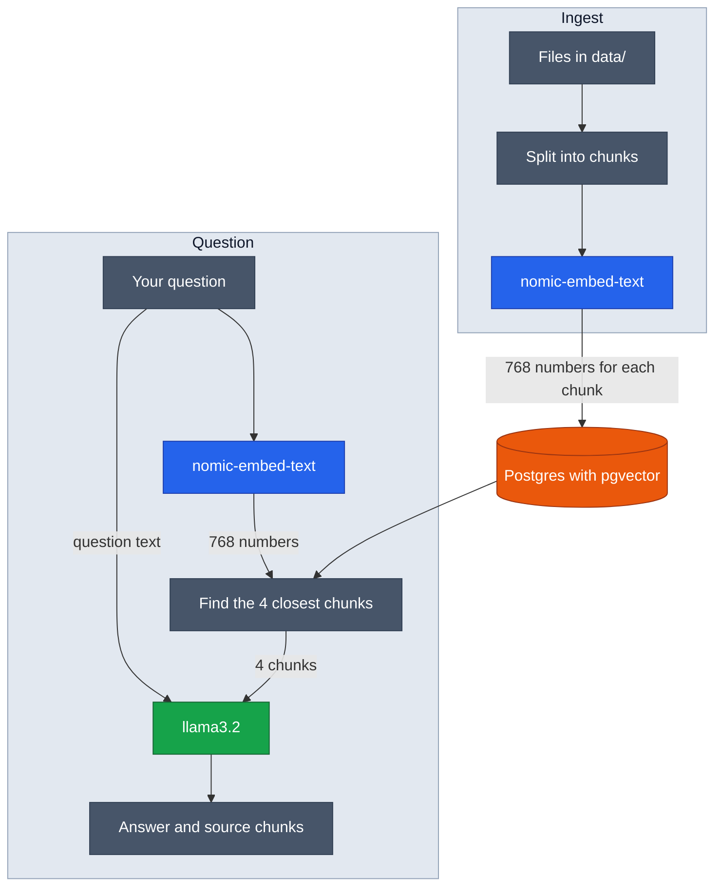

# RAG Document Assistant API

[](LICENSE)

A small API that answers questions about your own documents. Everything runs on your computer, so no paid AI service is needed.

It uses RAG (Retrieval-Augmented Generation): the app first finds the parts of your documents that match the question, then an AI model writes an answer using only those parts.

## How it works



**1. Ingest** runs once, and again when your documents change:

- Reads every `.md` and `.txt` file in `data/`.
- Splits each file into chunks of about 500 characters, with 50 characters of overlap.
- `nomic-embed-text` turns each chunk into an embedding: a list of 768 numbers that represents its meaning.
- Saves each chunk and its embedding in Postgres, using pgvector.

**2. Retrieve** runs for every question:

- `nomic-embed-text` turns the question into an embedding.
- Postgres finds the 4 chunks closest in meaning.

**3. Generate** runs only for `POST /ask`:

- The question and the 4 chunks go to `llama3.2`, with this instruction: "Answer only from the context. If it's not there, say you don't know."
- The API returns the answer and the chunks it used.

`POST /search` stops after step 2. It is useful for checking which chunks a question finds, without waiting for `llama3.2`.

## Tech stack

| Area      | Tools                                  |
| --------- | -------------------------------------- |
| Runtime   | Node.js 24, TypeScript                 |
| Framework | NestJS 12                              |
| Database  | PostgreSQL 18, pgvector, Prisma 7      |
| AI models | Ollama, `nomic-embed-text`, `llama3.2` |
| Testing   | Vitest, Supertest                      |
| Tooling   | Yarn 4, oxlint, Prettier, Docker       |

## Requirements

- Node.js 24
- Docker with Compose
- At least 5 GB of free memory, because `llama3.2` needs about 3 to 4 GB while it is loaded
- About 3 GB of free disk space for the two models

## Run it

Run every command inside the API folder.

**1. Get the code and use Node 24**

```bash
git clone https://github.com/Apu-Emdad/RAG-Document-Assistant-api.git
cd RAG-Document-Assistant-api
nvm install 24
nvm use 24
```

**2. Install the packages**

```bash
corepack enable
```

```bash
yarn install
```

Run `corepack enable` once for Node 24. It makes `yarn` use the project's Yarn 4.

**3. Create the settings file**

```bash
cp .env.example .env
```

**4. Start Postgres and Ollama in Docker**

```bash
yarn docker:deps
```

**5. Download the two models**

You only do this once. Docker keeps them in a volume.

```bash
docker exec rag-document-assistant-ollama ollama pull nomic-embed-text
```

```bash
docker exec rag-document-assistant-ollama ollama pull llama3.2
```

**6. Create the database table**

You only do this once. It turns on pgvector and creates the `chunks` table.

```bash
yarn migrate:dev
```

**7. Load the documents**

```bash
yarn ingest
```

Run it again after you add, change or delete a file in `data/`. It replaces all saved chunks.

**8. Start the API**

```bash
yarn dev
```

The API runs at `http://localhost:5000`, with Swagger docs at `http://localhost:5000/docs`.

**9. Stop the containers when you are done**

```bash
docker compose stop
```

This frees the memory. Your chunks and models are kept. Next time, you only need steps 4 and 8.

More detail is in [docs/local-setup.md](docs/local-setup.md).

## API

| Endpoint       | What it does                               |
| -------------- | ------------------------------------------ |
| `GET /health`  | Checks that the API is running             |
| `POST /search` | Returns the 4 chunks closest to a question |
| `POST /ask`    | Returns an answer and its source chunks    |

### Example: search

```bash
curl -X POST http://localhost:5000/search -H 'Content-Type: application/json' -d '{"question": "What is ingest?"}'
```

The response has this shape, with 4 chunks:

```json
{
  "status": 200,
  "message": "Chunks found",
  "data": {
    "chunks": [{ "content": "The text of the chunk", "source": "glossary.md" }]
  }
}
```

### Example: ask

```bash
curl -X POST http://localhost:5000/ask -H 'Content-Type: application/json' -d '{"question": "What is ingest?"}'
```

The response has this shape. Without a supported GPU, it can take up to about a minute.

```json
{
  "status": 200,
  "message": "Answer created",
  "data": {
    "answer": "The answer written by llama3.2",
    "sources": [{ "content": "The text of the chunk", "source": "glossary.md" }]
  }
}
```

## Scripts

| Command            | What it does                                     |
| ------------------ | ------------------------------------------------ |
| `yarn dev`         | Start the API in watch mode                      |
| `yarn docker:deps` | Start Postgres and Ollama                        |
| `yarn migrate:dev` | Apply or create database migrations              |
| `yarn ingest`      | Read `data/` and save the chunks                 |
| `yarn build`       | Compile to `dist/`                               |
| `yarn lint`        | Run oxlint                                       |
| `yarn typecheck`   | Check the TypeScript types                       |
| `yarn test`        | Run unit tests                                   |
| `yarn test:e2e`    | Run end-to-end tests with fake Prisma and Ollama |

## Project structure

```
data/           the documents the app answers from
prisma/         database schema and migrations
src/
  common/       error filter and logger, Result interface
  config/       checks the .env values on startup
  health/       health check
  infra/
    ollama/     calls to the Ollama models
    prisma/     database client
  modules/
    ingest/     splits documents and saves the chunks
    search/     POST /search
    ask/        POST /ask
  swagger/      Swagger UI changes
  ingest.ts     the ingest script
test/           end-to-end tests
```

## License

[MIT](LICENSE) © Emdadul Haque Apu
